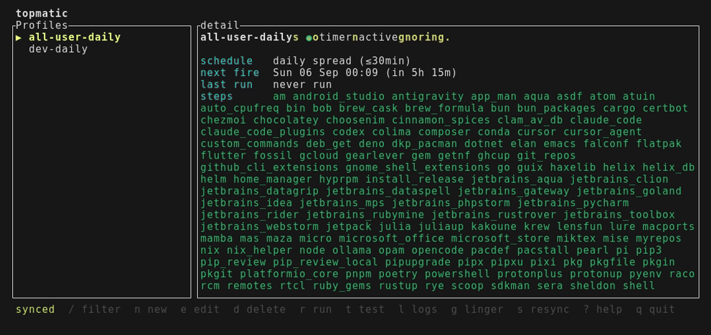
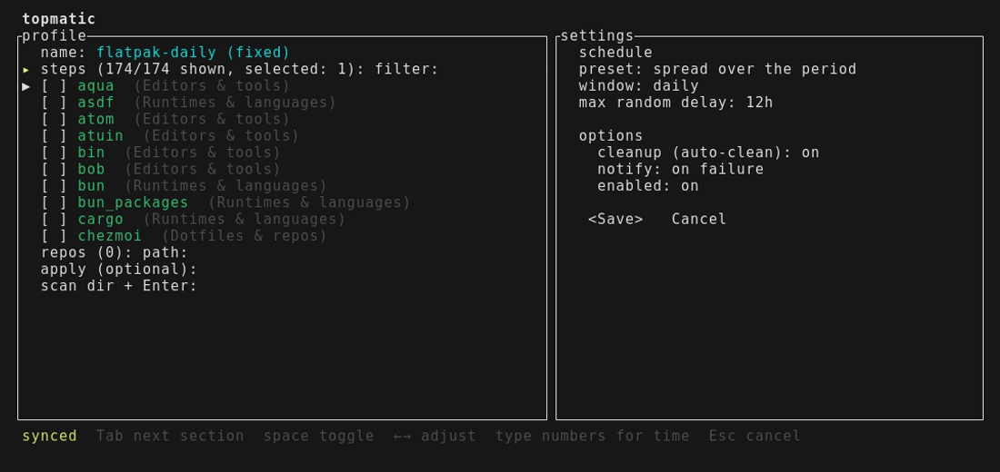
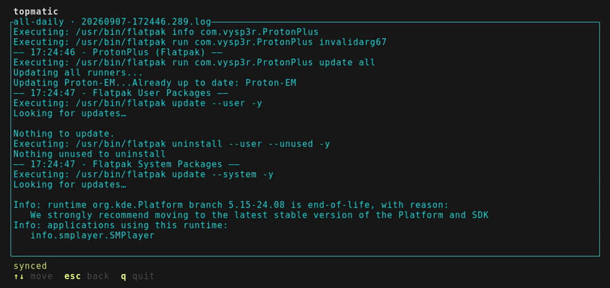

# Topmatic

[](https://crates.io/crates/topmatic)

Your user-level tools updated automatically without sudo.



Flatpaks, cargo installs, npm globals, pipx apps.
[Topgrade](https://github.com/topgrade-rs/topgrade) already knows how to update all of them.

Topmatic turns Topgrade into scheduled jobs you manage from a TUI.

## Why

- Automatic updates of **your** software without root, daemons or cron hacks
- Your own Topgrade config stays untouched.
  Topmatic always runs Topgrade with an isolated config
- Missed runs catch up on the next boot.
  Flaky runs self-heal behind a connectivity check
- Jobs run at minimum priority so they never get in your way
- Automatic cleanup after every run: Topmatic clears what Topgrade leaves behind
- Every start repairs drift.
  `topmatic doctor` diagnoses and `topmatic reset` starts clean

## Requirements

- Linux with **systemd** (user session).
  Works out of the box on Fedora, Ubuntu, Debian, Arch and openSUSE,
  plus derivatives like Mint and Zorin (Ubuntu family) and Bazzite (Fedora Atomic).
  systemd is the only scheduler supported today
- [Topgrade](https://github.com/topgrade-rs/topgrade) in `PATH`
  (17.11 or newer recommended: a few steps still prompt in unattended runs before it)
- Rust 1.85 or newer.
  Topmatic installs from source

## Install

### Fedora (COPR)

```sh
sudo dnf copr enable caiobruno/fedora-packages
sudo dnf install topmatic
```

### Nix: just run it

No install at all; downloads and runs the latest release:

```sh
nix run github:c4i0b/topmatic
```

### Nix: install into your profile

```sh
nix profile install github:c4i0b/topmatic
```

Both commands above serve the latest published release, not the
development branch, and update when you rerun them.

### Nix: add to your flake config

```nix
# flake.nix
{
  inputs.topmatic.url = "github:c4i0b/topmatic";

  outputs = { nixpkgs, topmatic, ... }: {
    nixosConfigurations.myhost = nixpkgs.lib.nixosSystem {
      system = "x86_64-linux";
      specialArgs = { inherit topmatic; };
      modules = [ ./configuration.nix ];
    };
  };
}
```

```nix
# configuration.nix
{ topmatic, ... }:
{
  environment.systemPackages = [ topmatic.packages.x86_64-linux.default ];
}
```

### Nix: add without flakes

The same package, imported directly in a classic config:

```nix
let
  topmatic = import (builtins.fetchTarball
    "https://github.com/c4i0b/topmatic/archive/main.tar.gz") { };
in
{
  environment.systemPackages = [ topmatic ];
}
```

The fetched `default.nix` pins its own nixpkgs and builds the latest
release, so no channel setup is needed.

### From source (any distro)

Needs Rust 1.85 or newer. From the official repos where they ship a
recent toolchain:

```sh
sudo dnf install rust cargo      # Fedora
sudo pacman -S rust              # Arch
sudo zypper install rust cargo   # openSUSE
```

Debian and Ubuntu carry Rust in their repos but usually too old for Topmatic.
Use rustup there (or anywhere):

```sh
curl --proto '=https' --tlsv1.2 -sSf https://sh.rustup.rs | sh
```

Then:

```sh
cargo install topmatic
```

Run `topmatic` once.
It installs the user units and converges the timers.

Topmatic refuses to run as root.
It manages your user's systemd session, so sudo would act on root's units instead.
Run it as your regular user.
Topmatic never runs anything privileged.

### When you log out

Systemd timers fire only while your session is open.
With linger on they keep firing after you log out, so updates happen on time even when you are away.
With linger off they wait for your next login, and missed runs catch up then.

Linger is off by default:

```sh
loginctl enable-linger    # let updates run without a session
loginctl disable-linger   # restore login-only updates
```

Topmatic shows the current state on the dashboard header and in `topmatic doctor`.

## Use

```sh
topmatic          # TUI
topmatic list     # profiles, next run, last status
topmatic steps    # what topgrade can update at user level here
topmatic doctor   # diagnose and repair unit drift
topmatic sync     # converge systemd units to the config
topmatic run <profile> [--dry-run]
```

Every key is shown in the footer of each screen.
`?` opens the full map.

### Presets

- Picking a preset activates it immediately.
  No name to type, no editor to cross
- `All` runs everything installed with no step list.
  It picks up steps Topgrade gains later
- `All` stays user-level: host-wide steps that need
  root (system packages, firmware, snaps) are disabled
  for you, while your own containers, distroboxes and
  toolboxes are updated
- Editing a preset keeps only your changes in the config
  (`extra_steps`, `excluded_steps`, schedule).
  Reverted overrides disappear again



Every run leaves a log you can browse with `l`:



## Config

- Profiles live in `~/.config/topmatic/config.toml`.
  Edit it by hand or via TUI
- A `[defaults]` table tunes retries, retry delays, give-up time,
  network wait and jitter.
  `config.example.toml` documents every key
- The config is the single source of truth and safe to share between machines.
  Do **not** share `~/.local/state/topmatic` (machine-local history)
  or `~/.config/systemd/user` (regenerates)

Topmatic only touches timers that carry its schedule drop-in.
Timers from other tools, even ones named `topmatic@*`,
are left alone and just reported.

## Development

Host prerequisites: `just` and `podman`. Everything else (Rust toolchain,
rustfmt, clippy, systemd-analyze) lives in the ephemeral tooling container.

```sh
just image      # build the tooling container (once, layer-cached)
just check      # fmt + clippy + offline test suite
just test-live  # real-systemd layer (bridged to the host user session)
```

`just --list` shows every recipe.
A few recipes stay host-side because they need the real host:
`deploy`, `verify`, `smoke` and the fixture recorders.
See [docs/](docs/README.md) for environment, testing and architecture.

## License

MIT
